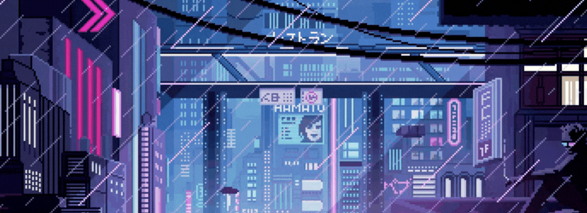

# 👋 Hi, I'm Iasmim Nunes

### 💻 Computer Science Student | Future IT Professional

 

---

# 👩‍💻 About Me

<table>
<tr>

<td width="60%">

### Hello! 👋

I'm **Iasmim Nunes**, a **Computer Science student** at **UNIFAJ**.

I'm passionate about technology and constantly improving my skills through academic projects and personal learning.

I'm currently looking for internship opportunities where I can contribute, learn from experienced professionals, and grow in the IT field.

### 🎯 Areas of Interest

💻 Software Development

🛠️ IT Support

📊 Data Analysis

🔐 Cybersecurity

### 🌱 Currently Learning

- Java
- Python
- SQL
- Computer Networks
- Data Structures
- Cybersecurity Fundamentals

### 🚀 Soft Skills

✔ Problem Solving

✔ Teamwork

✔ Fast Learning

✔ Communication

✔ Organization

✔ Continuous Learning

</td>

<td width="40%" align="center">

</td>

</tr>
</table>

---

# 💻 Tech Stack

### Languages

  

### Tools

  

### Currently Learning

---

# 📊 GitHub Analytics

  

&nbsp;

  

---

# 📚 Certifications

🥇 **Summer Code 2023.1** — 1st Place

📜 HTML — Fundação Bradesco

📜 CSS — Fundação Bradesco

---

# 🎯 2026 Goals

- 🎓 Continue growing in Computer Science
- 💻 Get my first IT internship
- ☕ Improve my Java skills
- 🌱 Learn Spring Boot
- 📊 Build Data Analysis projects
- 🔐 Study Cybersecurity
- 🌐 Contribute to Open Source
- 🚀 Keep improving every day

---

# 📫 Connect with Me

---

### ⭐ Thanks for visiting my profile!

*"Technology is about solving real problems and creating meaningful solutions."*

